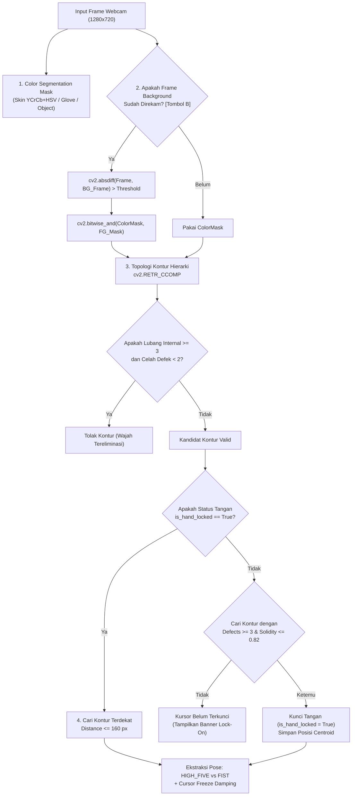

# Laporan Teknis Proyek 1 - Tipe 3: Whack-A-Mole Virtual Mini-Game (Pure OpenCV)

Mata Kuliah: Praktikum Pengolahan Citra dan Visi Komputer (PCV)  
Topik: *Virtual Interactive Whack-A-Mole Game with Classical PCD Pipeline, Hand Pose Classification, Adaptive Audio, Survival & Level Progression*  
Berkas Utama: [`main.py`](main.py) | [`game_engine.py`](game_engine.py) | [`hand_tracker.py`](hand_tracker.py) | [`audio_system.py`](audio_system.py) | [`ui_renderer.py`](ui_renderer.py) | [`entities.py`](entities.py) | [`save_manager.py`](save_manager.py) | [`config.py`](config.py)

---

## 1. Pendahuluan

**Whack-A-Mole Virtual** adalah game arcade interaktif berbasis *Computer Vision* murni (**OpenCV `cv2` & NumPy**) tanpa pustaka *deep learning* (tanpa MediaPipe, YOLO, TensorFlow, PyTorch) dan **tanpa XML Classifier (tanpa Haar Cascade)**.

Pembaruan utama sistem pada branch `safe-area` mencakup integrasi **Dual-Section Safe Area** dan **4 Pilar Pengolahan Citra Digital (PCD) Klasik**:
1. **Partisi Dual-Section Safe Area (Tombol `[H]` / `[TAB]`)**: Menolkan seluruh masker di luar Playing Section sehingga 100% wajah, kepala, rambut, dan tubuh pemain terblokir dari pelacakan.
2. **Background Subtraction Berbasis Referensi (Tombol `[B]`)**: Mengeliminasi dinding, meja, dan tubuh yang diam melalui selisih absolut (`cv2.absdiff()`).
3. **Eliminasi Wajah via Topologi Hierarki Kontur (`cv2.RETR_CCOMP`)**: Menghitung lubang internal mata, alis, dan mulut untuk mendiskualifikasi wajah tanpa memerlukan learning model.
4. **Mekanisme "Open-Palm Lock-On" & Nearest-Neighbor Tracking**: Sistem hanya mengunci kursor saat pemain menunjukkan telapak tangan terbuka (*HIGH_FIVE*), kemudian melacak kontur terdekat secara spasial termasuk saat mengepal (*FIST*) dengan Area Confidence Scoring.
5. **Sistem Klasifikasi 2 Hand Pose & Cursor Freeze**:
   - `HIGH_FIVE` (Open Palm): Berfungsi mengarahkan kursor bidikan (tidak memukul).
   - `FIST` (Kepalan Tangan): Berfungsi memukul mole (**WHACK!**) atau mengeklik tombol menu, dilengkapi *cursor position damping* saat jari mengepal.
6. **Jendela PiP Diagnostik Fitur Bentuk PCV (Tombol `[V]`)**: Menampilkan visualisasi real-time *Convex Hull*, titik *Convexity Defects*, nilai *Solidity*, *Aspect Ratio*, dan status pose.

---

## 2. Arsitektur Modular & Desain Sistem

```text
whack-a-mole/
│
├── config.py           # Parameter konstan: resolusi HD 1280x720, threshold defek, solidity, lock-on radius
├── audio_system.py     # Generator gelombang audio sintetis (NumPy stereo PCM) & BGM loop adaptif
├── save_manager.py     # Persistensi data progres: level unlock 1-10, rekor survival, kalibrasi, preferensi grid
├── hand_tracker.py     # Modul Vision 4 Pilar: BG Subtraction, RETR_CCOMP, Lock-On, Nearest-Neighbor & Pose
├── entities.py         # Model objek: Hole, Mole (multi-mole), HitEffect, ScoreManager, SurvivalTracker, Button
├── ui_renderer.py      # Modul visualisasi: Full Screen HUD, kursor dinamis (Move vs Whack), PiP Diagnostik
├── game_engine.py      # Mesin utama: State Machine (MENU, LEVEL_SELECT, GRID_SELECT, CALIBRATION, PLAYING, GAMEOVER)
├── main.py             # Entry point aplikasi: loop kamera, event hotkey ('B', 'V', 'M', 'C', 'S', 'ESC')
├── save_data.json      # File penyimpanan lokal progres pemain (dibuat otomatis)
└── README.md           # Laporan teknis dan dokumentasi lengkap
```

---

## 3. Metodologi 4 Pilar Pengolahan Citra Digital Klasik



### 3.1. Pilar 1: Background Subtraction Multi-Channel & Invalidation (Tombol `[B]` & `[N]`)
Pemain merekam kondisi latar belakang saat duduk santai di depan webcam dengan menekan tombol `[B]`:
$$\mathbf{I}_{\text{diff}}(x, y) = \max \left( \max_{c \in \{B, G, R\}} |\mathbf{I}_c - \mathbf{I}_{c,\text{bg}}|, |\mathbf{I}_{Cr} - \mathbf{I}_{Cr,\text{bg}}|, |\mathbf{I}_{Cb} - \mathbf{I}_{Cb,\text{bg}}| \right)$$
Untuk mencegah tangan ikut tereliminasi (*false subtraction*) akibat metamerisme intensitas grayscale antara kulit dan dinding/baju, sistem menerapkan **Static Background Artifact Invalidation**:
$$\mathbf{M}_{\text{static\_artifacts}} = \mathbf{M}_{\text{color\_bg}} \land (\mathbf{I}_{\text{diff}} < T_{\text{bg}})$$
$$\mathbf{M}_{\text{active}} = \mathbf{M}_{\text{color}} \land \neg \operatorname{dilate}(\mathbf{M}_{\text{static\_artifacts}})$$
Hanya objek yang *sudah ada dan sewarna kulit di background* (wajah yang diam, leher, meja kayu) yang dieliminasi. Tangan yang baru diangkat di depan dinding/baju dijamin 100% utuh! Pemain juga dapat menekan tombol **`[N]`** kapan saja untuk mereset/bypass background subtraction.

### 3.2. Pilar 2: Eliminasi Wajah via Topologi Hierarki Kontur (`cv2.RETR_CCOMP`)
Tanpa menggunakan Haar Cascade atau model deep learning apa pun, sistem membedakan wajah dari tangan menggunakan topologi lubang internal pada masker citra:
- Algoritma `cv2.findContours(..., cv2.RETR_CCOMP)` mengelompokkan kontur ke dalam hierarki dua tingkat: kontur eksternal (*parent* = -1) dan lubang internal (*child*).
- Wajah manusia secara alami memiliki komponen gelap (mata kiri, mata kanan, alis, dan mulut) yang menghasilkan $\ge 3$ lubang internal (*holes* dengan area $\ge 25\text{ px}$).
- **Aturan Eliminasi Wajah**: Kontur dengan $\text{Internal Holes} \ge 3$ dan $\text{Defek Celah Jari} < 2$ **otomatis ditolak**.

### 3.3. Pilar 3: Mekanisme "Open-Palm Lock-On", Area Confidence, & Nearest-Neighbor Tracking
Sistem **tidak pernah** langsung memilih kontur terbesar di layar (yang sering kali merupakan badan/baju):
1. **Filter Dimensi Minimal (`min-width`, `min-height`, `min-area`)**:
   - Kontur kandidat harus memenuhi $A \ge 2500\text{ px}$, lebar bounding box $w \ge 55\text{ px}$, dan tinggi $h \ge 55\text{ px}$.
   - Mencegah kursor terlempar ke garis rambut tipis, serpihan noise kecil, atau bayangan meja.
2. **Fase Pencarian (`is_hand_locked == False`)**:
   - Sistem mengurutkan kandidat kontur berdasarkan luas terbesar (`area` descending).
   - Sistem hanya akan mengunci kontur yang memenuhi kriteria telapak tangan terbuka (*HIGH_FIVE*):
     $$\text{Valid Defects} \ge 1 \quad (\theta < 85^{\circ}) \quad \lor \quad \text{Solidity} < 0.80$$
   - Wajah, leher, atau benda bulat tidak akan pernah lolos uji ini.
   - Begitu ditemukan, sistem mengaktifkan `is_hand_locked = True`, mencatat $A_0 = \text{area}$, dan menyimpan koordinat centroid $\mathbf{C}_0 = (cX, cY)$.
3. **Fase Pelacakan & Area Confidence Scoring (`is_hand_locked == True`)**:
   - Pada frame-frame berikutnya, sistem mengevaluasi semua kontur dalam radius $d \le 180\text{ px}$ menggunakan fungsi biaya **Area Confidence & Consistency**:
     $$\text{Total Cost} = d + \left|1.0 - \min\left(2.5, \frac{A}{A_{\text{last}}}\right)\right| \cdot 60.0 + \text{Penalti Serpihan} - \left(\frac{A}{A_{\text{max}}}\right) \cdot 40.0 + \text{Penalti Pose}$$
     * Penalti serpihan: $+90.0$ jika luas kontur $< 0.5 \times A_{\text{last}}$, mencegah pembajakan kursor oleh serpihan kecil di dekat tangan.
     * Bonus dominansi luas: $-40.0 \times (A / A_{\text{max}})$ untuk memprioritaskan kontur tangan utama.
     * Penalti pose: $+80.0$ jika bukan gestur tangan yang valid (*HIGH_FIVE* atau *FIST*).
   - Ketika tangan berubah dari telapak terbuka menjadi kepalan tangan (*FIST*), posisinya berada tepat di koordinat yang sama dan konsistensi luas terjaga, sehingga kursor tetap terkunci stabil tanpa melompat ke kepala, rambut, atau serpihan kecil.
   - Jika tangan keluar dari layar selama $> 24\text{ frame}$ (~0.8 detik), kunci dilepas otomatis dan sistem kembali ke fase pencarian.

### 3.4. Pilar 4: Ekstraksi Fitur Bentuk, Klasifikasi Pose, & Cursor Freeze
- **Klasifikasi 2 Pose**:
  - `HIGH_FIVE` (Move / Hover): Terdeteksi jika terdapat **minimal 1 titik merah sela jari terbuka** ($\text{Defects} \ge 1 \lor \text{Solidity} < 0.80$).
  - `FIST` (Whack / Click): Sisanya, yaitu saat jari mengepal rapat tanpa celah sela jari ($\text{Defects} == 0 \land \text{Solidity} \ge 0.80$).
- **Temporal Smoothing**: Buffer voting 5 frame untuk menghilangkan kedipan transisi.
- **Cursor Position Freeze**: Saat transisi ke *FIST*, posisi kursor dibekukan di koordinat *HIGH_FIVE* terakhir selama $0.35\text{ detik}$, menjamin pukulan mole tetap akurat.

---

## 4. Fitur Gameplay & Mekanika

### 4.1. Interaksi Kursor Gestur
- **Mengarahkan Kursor**: Buka telapak tangan (*HIGH_FIVE*). Kursor berwarna hijau dengan label `"MOVE (OPEN)"`.
- **Aksi Pukul (WHACK!) / Klik Menu**: Kepalkan tangan (*FIST*) tepat di atas lubang mole atau tombol menu. Kursor berubah menjadi merah pekat dengan efek impak dan label `"WHACK! (FIST)"`.

### 4.2. Pilihan Mode & Kustomisasi Grid
- **Pilihan Grid**: $2 \times 2$ (4 Lubang), $2 \times 3$ (6 Lubang - Default), $3 \times 3$ (9 Lubang), $3 \times 4$ (12 Lubang).
- **Mode Survival (Endless)**: 3 HP nyawa, intensitas dan tempo musik adaptif naik setiap 18 detik, kecepatan mole hingga 0.55s, mole ganda, dan *combo multiplier* hingga x4.
- **Mode Level (1 - 10)**: Perkembangan bertingkat dengan syarat membuka level berikutnya setelah menuntaskan level sebelumnya (tersimpan permanen di `save_data.json`).
- **Sintesis Audio Prosedural**: Efek suara sintetis stereo murni gelombang matematika NumPy.

---

## 5. Panduan Kontrol & Demonstrasi

Jalankan game dengan:
```bash
python whack-a-mole/main.py
```

| Tombol | Fungsi Demo |
| :--- | :--- |
| **`B`** | **Merekam Frame Referensi Latar Belakang** (*Background Subtraction*) |
| **`V` / `P`** | Menampilkan / menyembunyikan jendela **PiP Diagnostik PCV** (Hull, Defek, Solidity, Pose) |
| **`M`** | Berganti Preset Segmentasi (`Skin` $\to$ `Black Glove` $\to$ `High-Contrast Object`) |
| **`C`** | Kalibrasi Cepat Warna Kulit di ruangan demo |
| **`S`** | Menyalakan / mematikan audio sintetis |
| **`1` - `6`** | Pintasan angka menu utama |
| **`1` - `0`** | Memilih level 1 s.d. 10 pada layar Level Select |
| **`1` - `4`** | Memilih ukuran grid pada layar Grid Select |
| **`R`** | Mengulang permainan saat Game Over / Level Cleared |
| **`SPASI`** | Lanjut ke level berikutnya saat Level Cleared |
| **`ESC`** | Kembali ke Menu Utama / Keluar |
